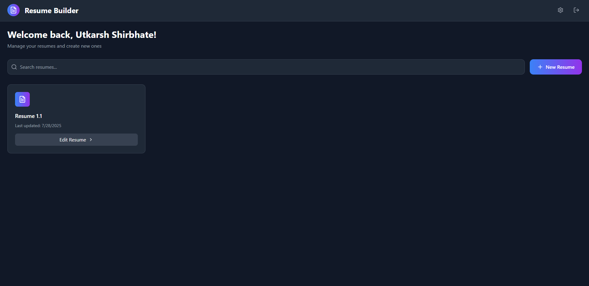
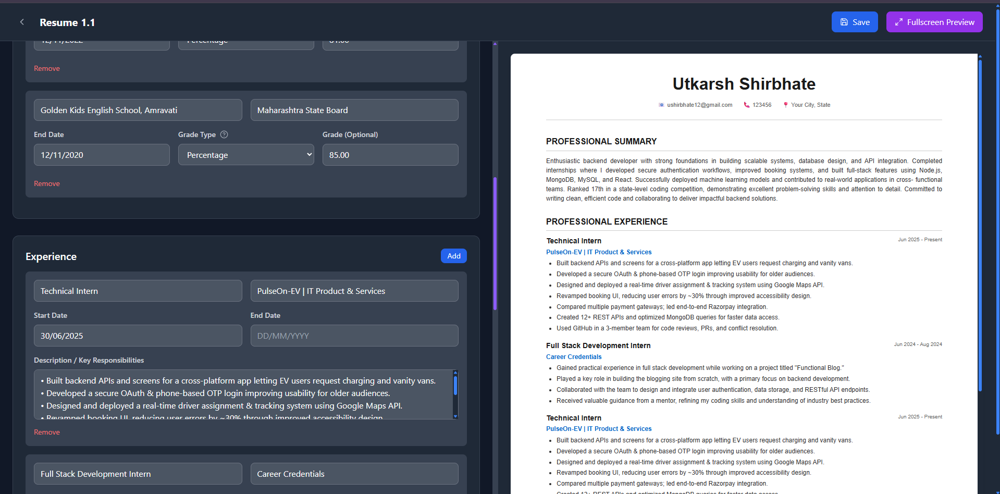

# 🚀 Resume Rocket  
### _Build, Edit, and Launch Professional Resumes — Right from Your Browser_

<!---[🌐 **Live Demo**](https://resume-rocket-frontend.onrender.com)  --->
[📦 **Source Code**](https://github.com/Vukung/Resume-Builder-Webapp/tree/Deployed)

---

## 🖼️ Screenshots


### 📝 Resume Editor + Live Preview  
Real-time section editing with instant preview  


---

### 🧭 Dashboard  
List, search, and manage resumes  


---

### 📝 Resume Editor  
Real-time editing with bulk controls  


---

---

## 🧠 Overview  
**Resume Rocket** is a full-stack MERN-style web app that empowers users to **create, edit, manage, and preview** resumes in real time.  
It features a sleek, responsive UI, robust backend, and end-to-end deployment on **Render**, with **PostgreSQL via Supabase**.

> 🔐 Beautifully styled and database-driven. Let’s rocket your resume into orbit.

---

## ✨ Features

### 🔐 Authentication
- JWT-based signup/login  
- Passwords hashed with `bcrypt`

### 🧭 User Dashboard
- List, search, duplicate, and soft-delete resumes  
- Keyboard-friendly navigation  
- Animated page transitions

### ✍️ Resume Editor
- Rich form sections: _About, Education, Experience, Projects, Certifications_  
- Add/edit/delete by section  
- Date/grade auto-formatting  
- Bulk clear feature

### 🌓 UI/UX
- Elegant glassmorphism + gradient icons  
- Smooth toast notifications for feedback

### 🧠 Smart DevOps
- IPv4-forced pooler URI from Supabase to avoid Render’s IPv6 bug

---

## 🛠️ Tech Stack

| Layer          | Tech Stack                                      |
|----------------|-------------------------------------------------|
| 💻 Frontend    | React 18, React Router 6, Tailwind, Lucide Icons |
| 🧠 Backend     | Node.js 20, Express 5, `pg` driver               |
| 🗄️ Database     | PostgreSQL 15 on Supabase (Free Tier)           |
| 🔒 Auth & Sec  | JWT, bcrypt, CORS                               |
| 🚀 Deployment  | Render (Backend as Web Service, Frontend as Static Site) |

---

## 🧑‍💻 Local Development

### ✅ Prerequisites
- Node.js ≥ 20  
- npm ≥ 9  
- PostgreSQL (or Supabase project)

---

### 🔃 1. Clone the Repository
```bash
git clone https://github.com/Vukung/Resume-Builder-Webapp.git
cd Resume-Builder-Webapp
git checkout Deployed


🔐 2. Setup Environment Variables
Create a .env file inside backend/:
# Backend
cd backend
npm install
npm run dev     # Starts Express on :5000

# Frontend (in a new terminal)
cd ../frontend
npm install
npm start       # Starts React on :3000


